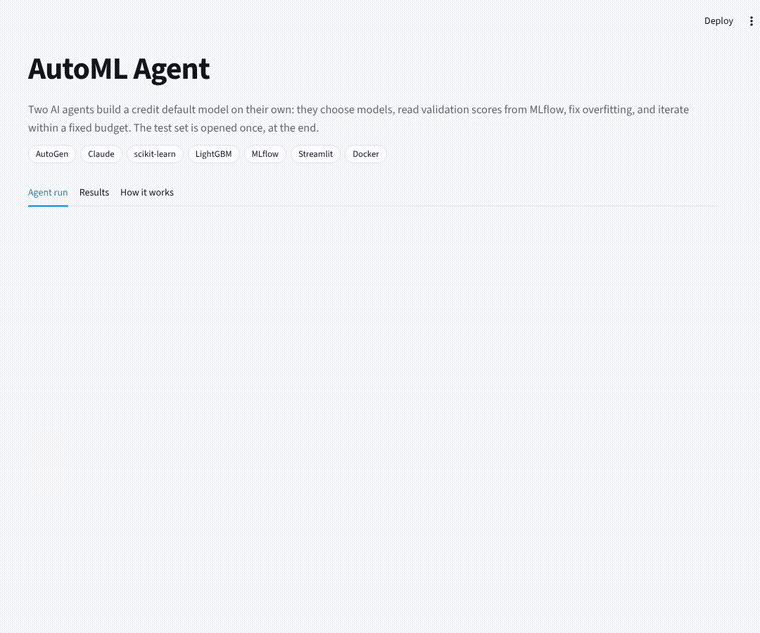
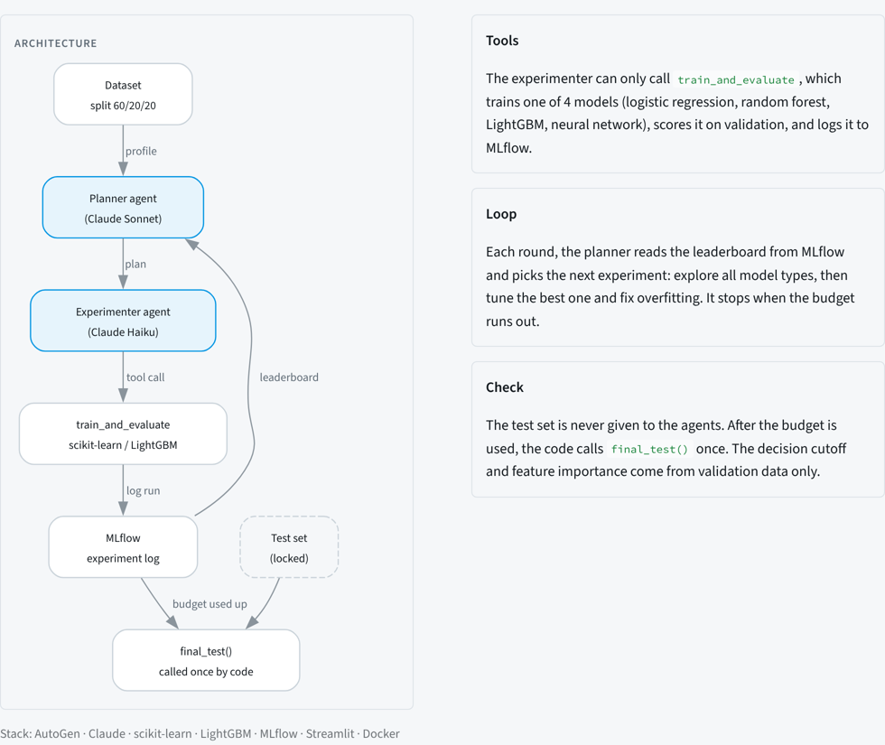
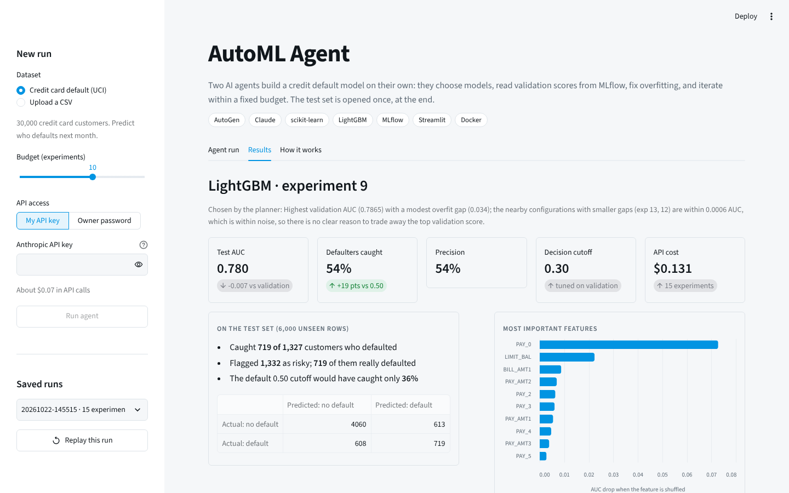
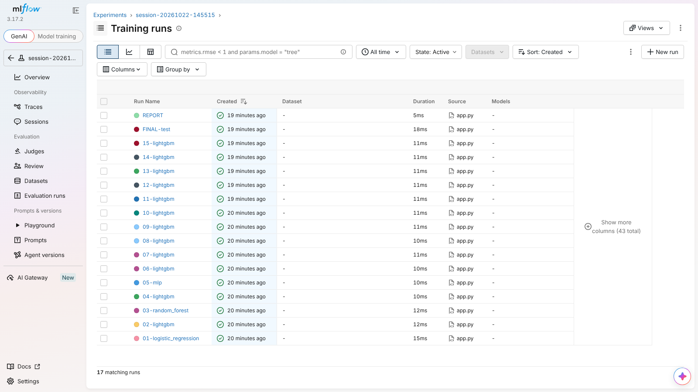

# AutoML Agent

**Two AI agents that build a credit default model on their own, within a fixed budget, without peeking at the test set.**

A planner agent reads the experiment log, decides what to try next and explains why. An experimenter agent trains the model. They repeat until the budget runs out, then the best model is tested once on data neither agent has ever seen.

**[▶ Live app](LIVE_APP_URL)** · **[📊 MLflow experiment log](MLFLOW_URL)**



---

## Results

Dataset: [Default of Credit Card Clients](https://archive.ics.uci.edu/dataset/350/default+of+credit+card+clients) (UCI). 30,000 customers, 23 features, 22% default next month.

| | |
|---|---|
| **Final model** | LightGBM, chosen by the planner (experiment 9 of 15) |
| **Validation AUC** | 0.787 |
| **Test AUC** (used once) | **0.780** |
| **Defaulters caught** | **54%** (719 of 1,327), up from 36% at the default 0.50 cutoff |
| **Precision** | 54% of flagged customers really defaulted |
| **Cost of the full run** | $0.13 in API calls |

**What the agent did:** it tried all four model families first (logistic regression 0.724, random forest 0.782, neural network 0.767, LightGBM 0.781). It noticed the first LightGBM was badly overfitting (train/validation gap of 0.14), regularized it down to about 0.03, and then tuned it to 0.787.

**Most important features:** `PAY_0` (last month's repayment status), `LIMIT_BAL` (credit limit), `BILL_AMT1` (last bill).

**Takeaways**
- **The decision cutoff matters as much as the model.** Tuning it on validation data (0.30 instead of 0.50) caught 19 percentage points more defaulters with the same model.
- **Diminishing returns.** After experiment 7, gains were under 0.002 AUC, which is within noise. The planner said so itself when picking the final model. A budget of about 8 would have reached nearly the same result for half the cost.
- **About 0.78 AUC is close to this dataset's ceiling.** More model search wouldn't move it much; the limit is the signal in the data, not the algorithm.

---

## How it works



**Tools.** The experimenter can only call `train_and_evaluate(model_type, params, features)`. It trains one of four models (scikit-learn logistic regression, random forest, MLP neural network, or LightGBM), scores it on the validation set, and logs everything to MLflow. Invalid settings are rejected with an error message and don't use budget.

**Loop.** Each round, the planner (Claude Sonnet) gets the data profile, the leaderboard read back from MLflow, the last result and the remaining budget, and returns one experiment with its reasoning. The experimenter (Claude Haiku) executes it. Each round starts a fresh conversation, so the planner's memory is MLflow itself, which keeps API costs low.

**Check.** The data is split 60/20/20 before anything starts. The test set is never loaded into the agents' tools: only `final_test()` reads it, and the code (not the AI) calls it exactly once after the budget is used up. The decision cutoff and feature importance are computed on validation data only.

---

## Screenshots

| Results | MLflow log |
|---|---|
|  |  |

---

## Run it yourself

**With Docker (app + MLflow dashboard):**
```bash
cp .env.example .env          # add your Anthropic API key
docker compose up --build
```
App: http://localhost:8501 · MLflow: http://localhost:5050

**Without Docker** (Python 3.12):
```bash
python3.12 -m venv .venv && source .venv/bin/activate
pip install -r requirements.txt
python src/prepare_data.py          # download + split the data
python src/run_agent.py --budget 15 # run in the terminal
streamlit run src/app.py            # or use the app
```
On a Mac, LightGBM needs `brew install libomp`.

## Project structure

```
src/
  prepare_data.py   download the UCI data, split 60/20/20, lock the test set
  tools.py          the agents' tools: profile, train_and_evaluate, leaderboard, final_test
  agents.py         AutoGen planner + experimenter and the experiment loop
  report.py         final report (Markdown + JSON, also logged to MLflow)
  run_agent.py      run from the terminal
  app.py            Streamlit app
  export_mlflow_snapshot.py   export the MLflow log for the public site
reports/            saved runs (the app replays these)
mlflow-space/       Docker setup for the public MLflow site (Hugging Face)
Dockerfile, docker-compose.yml
```

## Stack

AutoGen · Claude (Anthropic API) · scikit-learn · LightGBM · MLflow · Streamlit · Docker

## Notes

- **AutoGen is in maintenance mode** (Microsoft moved to the Microsoft Agent Framework in late 2025). It still works, but an Anthropic SDK update broke it during this project, so `anthropic<1` is pinned in `requirements.txt`.
- Built for the Machine Learning Fundamentals course, MS in Financial Technology and Analytics, UT Dallas.
